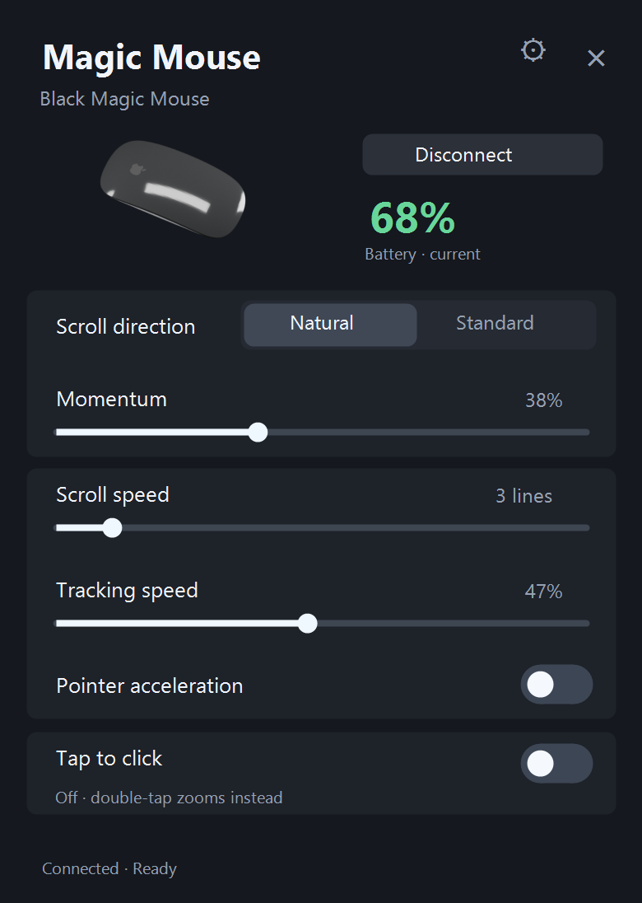
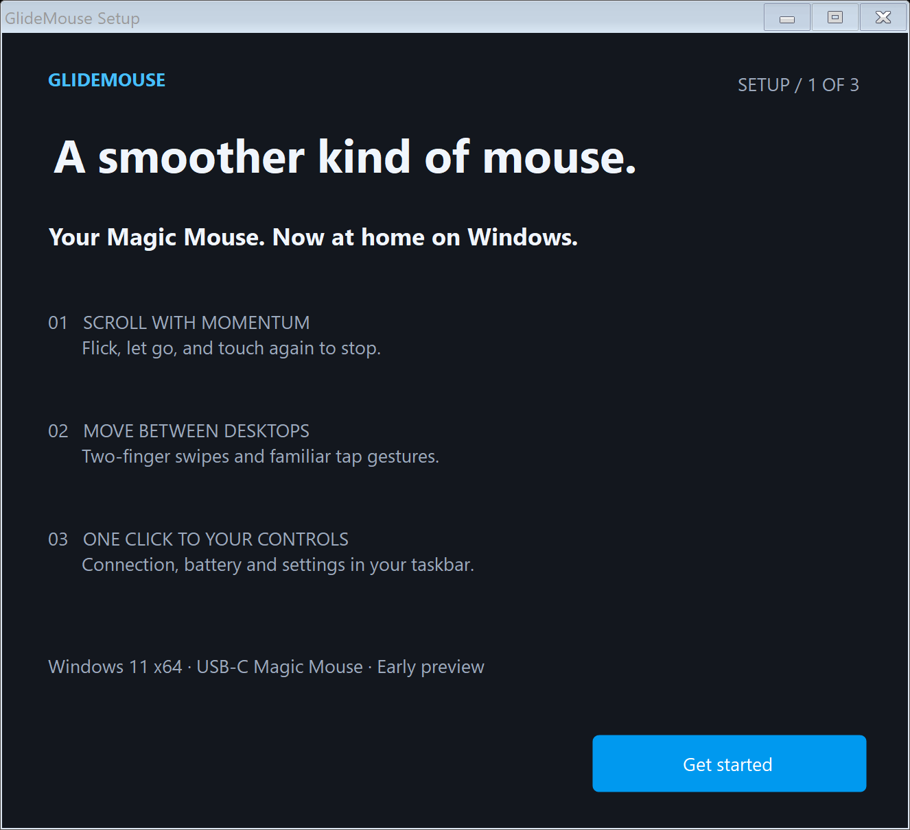
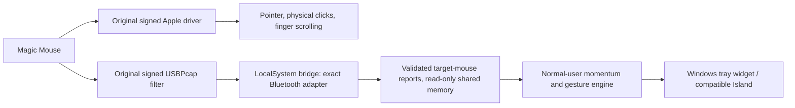

# GlideMouse

Momentum scrolling and gestures for the USB-C Magic Mouse on Windows.

Momentum that stops when you touch the mouse again. Two-finger desktop swipes.
Connection, battery and controls one click away in your Windows taskbar.

**Experimental alpha: USB-C Magic Mouse, Windows 11 x64.** The underlying signed USB
transport has been verified on one Intel USB Bluetooth/Lenovo system after a
normal Windows restart, with test signing off and memory integrity enabled.
Reconnect, momentum, touch-to-stop and gestures have also been tested on that system.
The generalized installer has not yet had a clean-machine installation test.
Other adapters and sleep/wake behaviour need broader community testing.

## Latest patch

[0.2.0 alpha](https://github.com/WendelinProfiler/GlideMouse/releases/tag/v0.2.0-alpha.1) adds an optional Mac companion and matching Windows host-switch add-on, plus direct input and battery support with Podglow. See [Mac companion setup](docs/MAC-COMPANION.md). Read the [release notes](RELEASE-NOTES.md) for the update steps and test limits.

## What you get

- Natural or standard scrolling, selected for this mouse only.
- Adjustable momentum, including Off, with touch-to-stop.
- Two-finger swipes between Windows virtual desktops and two-finger double-tap
  for Task View.
- Mechanical left/right clicks as the primary input. Optional tap-to-click.
- One-finger double-tap zoom when tap-to-click is off. This uses application
  zoom shortcuts; it is not macOS's content-aware Smart Zoom.
- A normal Windows notification-area icon and standalone controls. Windhawk is
  optional, not a prerequisite.
- Real Windows pointer speed, wheel-scroll speed and acceleration settings in
  the widget. Changing them here changes the same settings Windows uses.
- A connect/disconnect button and short reconnection instructions.
- Current battery when Windows exposes it; explicitly labelled last-known
  battery otherwise. No invented percentage.



UI preview rendered from the widget source with example battery data.

## Install

1. Pair and connect your USB-C Magic Mouse in **Windows Settings > Bluetooth &
   devices**. Disconnect it from your Mac first.
2. Download the Windows x64 ZIP from [Releases](https://github.com/WendelinProfiler/GlideMouse/releases),
   then **extract the entire ZIP**.
3. Run **GlideMouseSetup.exe**. The English wizard detects the mouse and its
   Bluetooth adapter, explains the components, and asks for administrator access
   only when you choose Install.
4. Save your work and restart Windows. Click the mouse outline in the Windows
   notification area after signing in. If it is in the overflow menu, drag it
   onto the taskbar's notification area.

The wizard never silently restarts Windows, changes Secure Boot, enables test
signing or disables memory integrity. Preview application executables are not
code-signed; the included original USBPcap kernel driver is Microsoft-attested.



### Requirements

- Windows 11 **x64**, not ARM64.
- USB-C Magic Mouse, Bluetooth Apple product ID `0323`. Older models are not
  advertised as supported by this alpha.
- A USB Bluetooth adapter directly attached to a USB root hub. The installer
  discovers the exact hub/port; it does not assume Intel hardware or a fixed
  port. PCIe/UART radios and external hub chains are currently unsupported.
- Administrator access for the initial driver/service installation.
- The original **Apple Wireless Mouse 6.1.7000** driver. It is proprietary and
  is **not bundled**. Setup can reuse the matching existing driver or accept
  your original `AppleWirelessMouse.inf`, with its adjacent `.cat` and `.sys` files, extracted from Apple's Windows support
  software. [Apple's support-software download instructions](https://support.apple.com/en-us/102465)
  describe obtaining that software on an Intel Mac. Use the matching file,
  rather than renaming or modifying a different driver.

Expected original AppleWirelessMouse.sys SHA-256:

```text
4B4A64722E3C5D1AC1C26C450D2C5AF74AA92BF01C3D7B6EAEDB81E00FBA5C84
```

Existing custom mouse filters or an existing GlideMouse/IslandMagicMouse
installation are left untouched. The first public installer does not perform
in-place migration of a development installation.

## Controls

The widget groups scrolling, Windows pointer settings and optional tap controls. The gear opens Windows mouse settings.

| Control | Behaviour |
| --- | --- |
| Connect / Disconnect | Disconnects or reconnects the selected mouse while preserving its pairing and installed HID driver. The result follows Windows' actual connection state. |
| Scroll direction | Natural by default. Changes apply through the installed service to this mouse only, without restarting Windows or showing another administrator prompt. Native scrolling and momentum use the same direction. |
| Momentum | Glide length, 0-100%. Applies without restarting Windows. |
| Scroll speed | Windows' wheel-scroll line count. The slider covers 1-20 lines and displays other existing Windows values without overwriting them. |
| Pointer speed | The actual Windows 1-20 pointer-speed setting. |
| Enhance pointer precision | The actual Windows acceleration setting. |
| Tap to click | Optional light left/right taps. Off by default; physical clicks remain available. |

If Connect cannot reach the mouse, switch it off and on, disconnect it from your
Mac, and open Windows Bluetooth settings to pair it. A switched-off mouse cannot
be remotely powered on. The mouse may remain paired when disconnected.

The icon uses a blue outline when connected and a grey outline when disconnected.
Click it again, click outside the widget, or press Escape to dismiss it.

## How it works



The kernel component is unmodified USBPcap, not a self-signed GlideMouse driver.
The bridge's service configuration pins the selected mouse, exact hub, adapter
vendor/product and port. USB device addresses are rediscovered after changes.
An address-bound handshake/SDP proof binds reports to the selected mouse.

The native Apple pointer/click/scroll path is preserved. The user process adds
only momentum and gestures. Temporary shared-memory read conflicts are retried
instead of discarding an in-progress gesture. Batched reports, briefly lost
finger contacts, resting fingers and small mouse-body nudges have regression
coverage.

Application gestures use normal Windows input injection; elevated applications
and protected/exclusive input surfaces can restrict it. Not every application
implements the zoom or page-navigation shortcuts in the same way.

### Privacy and permissions

The privileged bridge reads the selected Bluetooth USB adapter. Other Bluetooth
traffic can reach its memory and is immediately discarded. Only validated mouse
touch reports reach the read-only user mapping. **No raw packet files, screen
recording, network telemetry or cloud account are used.** USBPcap is registered
on the selected root hub only; no class-wide USB filter is added by our installer.

Only SYSTEM/administrators can write the shared memory. The configured user has
read access. This alpha targets one configured mouse and one Windows user.

## Uninstall

Use **Windows Settings > Apps > Installed apps > GlideMouse > Uninstall**.
The uninstaller stops our components, removes registrations that our installer
added and restores its recorded scroll settings. It preserves pre-existing
filters/services and user settings. Restart Windows to unload the USB filter.
Loaded driver files are retained as inert files rather than deleted while in use.

## Build and test

Install Visual Studio Build Tools with Desktop development with C++, a Windows
SDK, and CMake. The wizard uses the Windows .NET Framework compiler, so no
additional runtime download is needed.

```powershell
.\Build.ps1
```

An LLVM-MinGW compiler can also be supplied explicitly:

```powershell
.\Build.ps1 -Compiler C:\tools\llvm-mingw\bin\clang++.exe
```

Tests cover gesture behaviour, optional taps, timing, report parsing, malformed
and unrelated packets, standalone popup placement/dismissal, Windows-setting
readback and mock installer discovery. Installer tests do not alter drivers.
`TestHubBinding.cpp` is an optional metadata-only hardware diagnostic, not part
of automatic capture tests.

To build a release, install 7-Zip and run `Build.ps1 -Package`. Packaging verifies
the original USBPcap installer and driver hashes, extracts it without executing
its installer, and bundles upstream's matching corresponding-source archive.
The release ZIP includes a file checksum manifest. Apple drivers and local
diagnostics are excluded.

## Contributing

Please include your Windows build, mouse model, adapter vendor/product and a
description of the action that failed. Do not upload Bluetooth captures, device
addresses, Windows SIDs or full diagnostic logs containing personal information.

The first compatibility priority is clean-machine installation and more USB
Bluetooth adapters, followed by sleep/wake and multi-monitor coverage.

## License

GlideMouse code is MIT licensed. USBPcap components keep their upstream licenses.
See [third-party notices](THIRD_PARTY_NOTICES.md). This is an independent community
project, not an Apple or Microsoft product.
